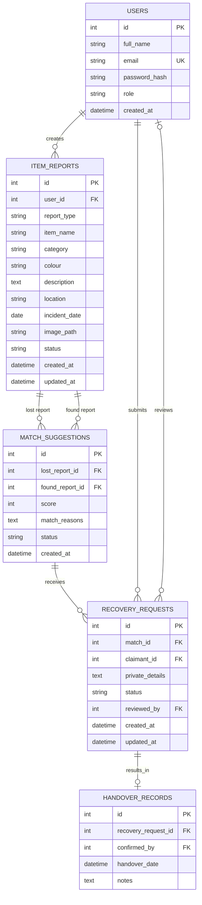

# FindIt — University Lost-and-Found Item Matching Platform

> **Project type:** Two-person university web development assignment  
> **Required technologies:** HTML, CSS, JavaScript, PHP, and MySQL  
> **Project goal:** Build a manageable, secure website that helps students and staff report lost/found items, discover possible matches, and manage recovery requests.

---

## 1. Project overview

### 1.1 Problem statement

Students and staff sometimes lose belongings such as student ID cards, keys, notebooks, bags, and accessories. Information about lost and found items can be scattered across messaging groups, noticeboards, and informal conversations. This makes it difficult to know whether an item has been found.

**FindIt** provides one central place to publish lost and found reports, compare reports for possible matches, and manage claims and handovers.

### 1.2 Main objectives

1. Allow users to register, log in, and log out securely.
2. Let users create and manage lost/found item reports.
3. Allow users to search and filter reports.
4. Compare lost and found reports automatically and explain why they may match.
5. Let users submit and track recovery requests.
6. Let administrators moderate reports and oversee recovery.

### 1.3 Users and permissions

| Role | Permissions |
|---|---|
| Visitor | View public pages and browse public reports; cannot submit reports or claims |
| Registered user | Create reports, edit/withdraw their own reports, view relevant match suggestions, submit claims, and track their own requests |
| Administrator | Review/hide reports, oversee claims, record outcomes, and manage resolved cases |

Create an administrator account through a controlled setup process or a seeded database record. **Do not provide public administrator registration.**

### 1.4 Keep the first version achievable

**Build these core features:**
- Registration, login, logout, sessions, and role checks
- Lost/found reports
- Search and filters
- Rule-based match suggestions
- Recovery requests and status tracking
- Basic admin moderation
- A clear, responsive interface

**Leave these out of the first version:**
- Email/SMS notifications
- Live chat
- GPS tracking
- AI image recognition
- A separate mobile app
- External identity-verification integrations

You can describe these as possible future improvements in the presentation.

---

## 2. How the technologies work together

Use the required stack directly. Do not introduce a framework unless the lecturer has approved it.

### 2.1 Request flow

1. A user opens a PHP page in their browser.
2. The browser displays the HTML structure and CSS styling.
3. JavaScript handles browser-side interactions and simple validation.
4. When the user submits a form, the browser sends a request to a PHP endpoint/page.
5. PHP validates the input and checks the user's session and permissions.
6. PHP uses **PDO prepared statements** to read from or write to MySQL.
7. PHP returns a rendered HTML page or a redirect, and the browser displays the result.

```text
User / Browser
   |
   | HTML forms, links, CSS, JavaScript
   v
PHP page / service
   |
   | validate input, authenticate, authorize
   v
PDO prepared statement
   |
   v
MySQL database
   |
   | results
   v
PHP renders response -> Browser
```

### 2.2 Responsibilities by technology

| Technology | Main responsibility in FindIt | Example |
|---|---|---|
| HTML | Page structure and forms | Report form, navigation, report cards |
| CSS | Layout, colours, spacing, responsiveness, states | Navigation bar, cards, forms, status labels |
| JavaScript | Browser interactions and convenience checks | Confirm withdrawal, preview an image, toggle filters |
| PHP | Server-side rules, sessions, validation, database work | Save reports, calculate matches, process claims |
| MySQL | Persistent data and relationships | Users, reports, match suggestions, recovery requests |

**Important:** JavaScript validation improves usability, but PHP must validate again. Users can bypass browser-side checks. PHP is the authority for permissions and data changes.

---

## 3. Requirements and scope

### 3.1 Functional requirements

- A user can register with a unique email address.
- A user can log in and log out.
- A registered user can create a lost or found report.
- A user can edit or withdraw only their own eligible reports.
- Users can browse and filter active reports.
- The system can compare a lost report with found reports and show a score and reasons.
- A user can submit a recovery request for a suggested match.
- A user can view the status of their own reports and claims.
- An administrator can moderate reports and review recovery requests.
- A completed handover can be recorded, and the relevant report can be marked resolved.

### 3.2 Non-functional requirements

- Passwords are stored as secure hashes, never as plain text.
- Database queries use prepared statements.
- Access control is checked on the server.
- Private claim information is not displayed publicly.
- Forms and uploads are validated.
- Pages are usable on desktop and mobile-sized screens.
- Errors are handled clearly without exposing passwords, SQL, or server internals.

### 3.3 Decisions to make before coding

Agree with your partner on:
- The institution/campus locations used in the dropdowns
- Item categories and permitted report statuses
- Whether report photos are optional (recommended: yes)
- Who may see public reports (recommended: everyone can browse, but only registered users can report/claim)
- How an administrator is created
- The exact workflow for approving a claim and recording a handover

Write these decisions down before dividing the implementation work.

---

## 4. User journeys

### 4.1 Submit a lost item

1. User registers or logs in.
2. User chooses **Report an item** and selects **Lost**.
3. User enters the item name, category, colour, description, location, and incident date.
4. PHP validates the fields and optional photo.
5. PHP stores the report in MySQL.
6. The matching service compares it with compatible found reports.
7. The user can view possible matches and the reasons behind each suggestion.

### 4.2 Submit a found item

1. A registered user selects **Found**.
2. They enter the public description and where/when it was found.
3. PHP saves the report.
4. The matching service compares it with active lost reports.
5. The system displays possible matches without revealing private claimant details.

### 4.3 Recover an item

1. A user opens a suggested match.
2. The user submits a recovery request and provides private details that can help verify ownership.
3. The request is saved with a pending status.
4. The responsible user/admin reviews the request according to the agreed workflow.
5. The outcome is approved or rejected.
6. After a real handover is confirmed, record it and mark the relevant report(s) resolved.

**Privacy principle:** Do not publish every identifying detail. For example, a public report can say “black wallet” while keeping a specific card, inscription, or contents private for ownership verification. Never ask users to post passwords, PINs, or other account secrets.

---

## 5. Pages and navigation

Recommended pages for the first version:

| File | Purpose | Access |
|---|---|---|
| `index.php` | Home page and recent active reports | Public |
| `register.php` | Create an account | Public |
| `login.php` | Log in | Public |
| `logout.php` | End the session | Logged-in users |
| `browse.php` | Browse/search/filter reports | Public |
| `report-create.php` | Create a lost/found report | Logged-in users |
| `report-details.php` | Show one report and available actions | Public details; private actions require login |
| `my-reports.php` | List the current user's reports | Logged-in users |
| `my-matches.php` | Show match suggestions relevant to the user | Logged-in users |
| `my-claims.php` | Show the current user's recovery requests | Logged-in users |
| `claim.php` | Submit a recovery request for a match | Logged-in users |
| `admin/index.php` | Admin overview | Administrator |
| `admin/reports.php` | Review/moderate reports | Administrator |
| `admin/claims.php` | Review recovery requests and outcomes | Administrator |

You may add `report-edit.php` or use a carefully designed create/edit handler. Keep URLs and form actions understandable.

### Basic navigation

```text
Home
├── Browse items
├── Log in / Register
└── (Logged in)
    ├── Report an item
    ├── My reports
    ├── My matches
    ├── My claims
    └── (Administrator only)
        ├── Admin overview
        ├── Manage reports
        └── Manage claims
```

---

## 6. Folder and file structure

Start with a structure similar to this. You can adjust it with your partner, but agree on it before both of you create files.

```text
findit/
├── index.php
├── register.php
├── login.php
├── logout.php
├── browse.php
├── report-create.php
├── report-edit.php
├── report-details.php
├── my-reports.php
├── my-matches.php
├── my-claims.php
├── claim.php
│
├── admin/
│   ├── index.php
│   ├── reports.php
│   └── claims.php
│
├── config/
│   └── database.php
│
├── includes/
│   ├── auth.php
│   ├── csrf.php
│   ├── header.php
│   ├── footer.php
│   └── functions.php
│
├── services/
│   ├── ReportService.php
│   ├── MatchingService.php
│   └── RecoveryService.php
│
├── assets/
│   ├── css/
│   │   └── style.css
│   ├── js/
│   │   └── app.js
│   └── images/
│       └── logo-placeholder.png
│
├── uploads/
│   └── reports/
│
├── database/
│   ├── schema.sql
│   └── seed.sql
│
├── tests/
│   └── test-cases.md
│
├── .gitignore
└── README.md
```

### What belongs where?

- `config/database.php`: PDO connection settings only. Do not commit real production credentials.
- `includes/auth.php`: login checks, current-user helper, role checks.
- `includes/csrf.php`: generate and validate CSRF tokens for forms.
- `includes/header.php` / `footer.php`: shared page layout.
- `includes/functions.php`: small reusable helpers such as escaping output.
- `services/ReportService.php`: report-related database operations and rules.
- `services/MatchingService.php`: candidate selection and match scoring.
- `services/RecoveryService.php`: claim/recovery workflow.
- `assets/css/style.css`: all shared styles.
- `assets/js/app.js`: progressive enhancement, image preview, confirmations, and other browser-side behaviour.
- `database/schema.sql`: tables, keys, indexes, constraints.
- `database/seed.sql`: optional sample categories/reports and a safely hashed test admin account.
- `uploads/reports/`: optional uploaded images. Never allow uploaded PHP or other executable files to run here.
- `README.md`: setup instructions, features, roles, test steps, and team contributions.

### Suggested `.gitignore`

```gitignore
/config/local.php
.env
/uploads/reports/*
!/uploads/reports/.gitkeep
```

If you use a different configuration file for local credentials, ignore that file too. Do not commit real passwords, API keys, or private data.

---

## 7. Database design

Use MySQL with foreign keys. Use InnoDB tables and a consistent character set such as `utf8mb4`.

### 7.1 Core tables

#### `users`

| Column | Suggested type | Notes |
|---|---|---|
| `id` | `INT UNSIGNED` | Primary key, auto-increment |
| `full_name` | `VARCHAR(120)` | Required |
| `email` | `VARCHAR(190)` | Required, unique |
| `password_hash` | `VARCHAR(255)` | Output from PHP `password_hash()` |
| `role` | `ENUM('user','admin')` or validated equivalent | Default `user` |
| `created_at` | `DATETIME` | Default current timestamp |

#### `item_reports`

| Column | Suggested type | Notes |
|---|---|---|
| `id` | `INT UNSIGNED` | Primary key |
| `user_id` | `INT UNSIGNED` | FK to `users.id` |
| `report_type` | `ENUM('lost','found')` | Which kind of report |
| `item_name` | `VARCHAR(120)` | Required |
| `category` | `VARCHAR(60)` | Prefer controlled categories |
| `colour` | `VARCHAR(60)` | Optional but useful for matching |
| `description` | `TEXT` | Do not require private identifying secrets |
| `location` | `VARCHAR(120)` | Prefer predefined campus locations |
| `incident_date` | `DATE` | When lost/found |
| `image_path` | `VARCHAR(255)` | Nullable; store a generated filename/path, not image bytes |
| `status` | `ENUM('active','under_review','resolved','withdrawn')` | Default `active` |
| `created_at` | `DATETIME` | Creation timestamp |
| `updated_at` | `DATETIME` | Update timestamp |

#### `match_suggestions`

| Column | Suggested type | Notes |
|---|---|---|
| `id` | `INT UNSIGNED` | Primary key |
| `lost_report_id` | `INT UNSIGNED` | FK to a lost report |
| `found_report_id` | `INT UNSIGNED` | FK to a found report |
| `score` | `TINYINT UNSIGNED` or `SMALLINT UNSIGNED` | Keep the score in the intended 0–100 range |
| `match_reasons` | `TEXT` or JSON | Human-readable reasons or structured reasons |
| `status` | `ENUM('suggested','dismissed','accepted','closed')` | Suggestion workflow |
| `created_at` | `DATETIME` | Creation/update strategy should be defined |
|  |  | Add a unique constraint on (`lost_report_id`, `found_report_id`) |

#### `recovery_requests`

| Column | Suggested type | Notes |
|---|---|---|
| `id` | `INT UNSIGNED` | Primary key |
| `match_id` | `INT UNSIGNED` | FK to `match_suggestions.id` |
| `claimant_id` | `INT UNSIGNED` | FK to `users.id` |
| `private_details` | `TEXT` | Private verification information; restrict access |
| `status` | `ENUM('pending','approved','rejected','completed')` | Default `pending` |
| `reviewed_by` | `INT UNSIGNED` | Nullable FK to `users.id` |
| `created_at` | `DATETIME` | Creation timestamp |
| `updated_at` | `DATETIME` | Update timestamp |

#### `handover_records`

| Column | Suggested type | Notes |
|---|---|---|
| `id` | `INT UNSIGNED` | Primary key |
| `recovery_request_id` | `INT UNSIGNED` | FK to `recovery_requests.id`; unique if each request can have at most one handover |
| `confirmed_by` | `INT UNSIGNED` | FK to `users.id` |
| `handover_date` | `DATETIME` | Actual confirmed handover date/time |
| `notes` | `TEXT` | Optional non-sensitive notes |

**Design note:** The schema above is a starting point, not a substitute for checking your exact workflow. Agree on whether a found report can have several claims, who approves a claim, and when reports become resolved. Add unique constraints and indexes that enforce those decisions.

### 7.2 Relationship diagram (ERD)



### 7.3 Relationships in plain English

- One user can create many reports; each report belongs to one user.
- A report can appear in many suggestions as a lost report or as a found report.
- Every suggestion links one lost report to one found report.
- One suggestion can receive recovery requests; each request is submitted by one user.
- A user may review many requests, but a request may not yet have a reviewer.
- A completed recovery request can have a handover record. The unique key on `recovery_request_id` makes the relationship at most one handover per request.

### 7.4 Database rules to enforce

- `users.email` must be unique.
- `match_suggestions` must not contain duplicate lost/found pairs.
- The lost side of a suggestion must reference a `lost` report; the found side must reference a `found` report. Validate this in PHP, and consider stronger database enforcement if your schema design supports it.
- Prevent a report from matching itself.
- Use foreign keys and sensible delete rules. Prefer retaining historical records instead of deleting records that have claims or handovers.
- Add indexes for common filters such as report type, status, category, location, and incident date.
- Never store a plain-text password.

---

## 8. Matching algorithm

The match engine is the feature that makes FindIt more than a normal reporting form.

### 8.1 Matching flow

1. A lost or found report is created or edited.
2. PHP determines its type.
3. PHP queries only **active reports of the opposite type**.
4. Each candidate is scored based on matching fields.
5. Candidates below the agreed threshold are ignored.
6. Suggestions are saved or updated, without duplicate report pairs.
7. The user sees the highest-scoring suggestions and reasons.
8. Resolved, withdrawn, or otherwise ineligible reports are excluded.

### 8.2 Initial scoring rules

These weights are a starting heuristic for a class project. They are **not validated probabilities** and do not prove that an item belongs to someone.

| Signal | Initial points |
|---|---:|
| Same category | 30 |
| Same/compatible colour | 20 |
| Same or nearby predefined location | 20 |
| Dates close enough | 20 |
| Relevant description overlap | 10 |
| **Maximum** | **100** |

Start with a threshold around **50/100**, then test it using sample reports and adjust it if it produces too many weak matches or misses obvious ones.

### 8.3 Example

Lost report:
- Category: Water bottle
- Colour: Blue
- Location: Library
- Date: 12 October

Found report:
- Category: Water bottle
- Colour: Blue
- Location: Near the library
- Date: 12 October

Illustrative score: category 30 + colour 20 + nearby location 20 + close date 20 + description overlap 5 = **95/100**.

The interface might explain:
- Same category
- Same colour
- Found near the reported location
- Same incident date
- Similar description

The score should be shown as a **match score**, not “95% certainty.”

### 8.4 Matching implementation guidance

- Put matching logic in `services/MatchingService.php`, not scattered across page templates.
- Use SQL to retrieve candidates; use PHP to compare and score them.
- Keep locations and categories consistent using dropdowns where practical.
- Define “close date” and “nearby location” explicitly in code.
- Store reasons as structured data or a simple list that can be displayed safely.
- Recalculate or refresh suggestions when relevant report fields change.
- Exclude pairs where either report is resolved, withdrawn, or otherwise inactive.
- Ensure the same pair is not inserted twice. A database unique constraint is the final safeguard.
- Treat scores as hints. A human must verify ownership and recovery.

---

## 9. HTML implementation plan

### 9.1 Use semantic HTML

Prefer:
- `<header>` for the page header
- `<nav>` for navigation
- `<main>` for the main content
- `<section>` for grouped content
- `<article>` for an individual report card
- `<form>`, `<label>`, and the appropriate input types for forms
- `<footer>` for the page footer

Each page should have a meaningful `<title>`, a viewport meta tag, and a clear heading hierarchy.

### 9.2 Example report form structure

```html
<form action="report-create.php" method="post" enctype="multipart/form-data">
  <label for="report_type">Report type</label>
  <select id="report_type" name="report_type" required>
    <option value="">Choose one</option>
    <option value="lost">I lost an item</option>
    <option value="found">I found an item</option>
  </select>

  <label for="item_name">Item name</label>
  <input id="item_name" name="item_name" type="text" maxlength="120" required>

  <label for="category">Category</label>
  <select id="category" name="category" required>
    <option value="">Choose a category</option>
    <option value="ID card">ID card</option>
    <option value="Keys">Keys</option>
    <option value="Bag">Bag</option>
    <option value="Electronics">Electronics</option>
    <option value="Stationery">Stationery</option>
    <option value="Other">Other</option>
  </select>

  <label for="colour">Colour</label>
  <input id="colour" name="colour" type="text" maxlength="60">

  <label for="location">Location</label>
  <select id="location" name="location" required>
    <option value="">Choose a location</option>
    <option value="Library">Library</option>
    <option value="Lecture hall">Lecture hall</option>
    <option value="Cafeteria">Cafeteria</option>
    <option value="Other campus area">Other campus area</option>
  </select>

  <label for="incident_date">Date lost/found</label>
  <input id="incident_date" name="incident_date" type="date" required>

  <label for="description">Description</label>
  <textarea id="description" name="description" rows="4" maxlength="2000" required></textarea>

  <label for="photo">Optional photo</label>
  <input id="photo" name="photo" type="file" accept="image/jpeg,image/png,image/webp">

  <!-- Include a CSRF token field generated by PHP here. -->
  <button type="submit">Submit report</button>
</form>
```

This is an illustrative form. The real PHP page must validate every submitted field, verify the session, verify the CSRF token, and safely handle an optional upload.

### 9.3 HTML checklist

- [ ] Labels are connected to inputs with matching `for` and `id`.
- [ ] Required fields use `required` where appropriate.
- [ ] Input lengths and types make sense.
- [ ] Forms show server-side validation messages.
- [ ] Buttons have clear labels.
- [ ] Tables (if used) have headers.
- [ ] Status is conveyed in text, not only by colour.
- [ ] Image uploads use `multipart/form-data`.
- [ ] Every page has consistent navigation and footer.

---

## 10. CSS implementation plan

Keep the design simple and consistent. Prioritize clarity over decoration.

### 10.1 Suggested design system

Choose a small set of design tokens and reuse them:
- One primary colour for main actions
- Neutral background and card colours
- One font stack
- Consistent spacing scale
- Consistent border radius and shadow
- Clear success, warning, and error styles

Do not use colour alone to communicate status. Include text such as “Pending,” “Approved,” or “Resolved.”

### 10.2 Suggested CSS organization

You can keep everything in `assets/css/style.css` for this project, organized in sections:
1. CSS variables/reset
2. Base typography and page layout
3. Header/navigation
4. Buttons and links
5. Forms and validation messages
6. Report cards and match score
7. Status labels
8. Tables and admin pages
9. Responsive rules
10. Accessibility/focus states

### 10.3 Starter CSS

```css
:root {
  --color-primary: #2457a7;
  --color-primary-hover: #1c4485;
  --color-text: #1f2937;
  --color-muted: #64748b;
  --color-background: #f5f7fb;
  --color-surface: #ffffff;
  --color-border: #dbe2ea;
  --radius: 0.75rem;
  --space-1: 0.25rem;
  --space-2: 0.5rem;
  --space-3: 0.75rem;
  --space-4: 1rem;
  --space-6: 1.5rem;
  --space-8: 2rem;
}

* {
  box-sizing: border-box;
}

body {
  margin: 0;
  color: var(--color-text);
  background: var(--color-background);
  font-family: system-ui, -apple-system, BlinkMacSystemFont, "Segoe UI", sans-serif;
  line-height: 1.5;
}

img {
  max-width: 100%;
  height: auto;
}

.container {
  width: min(100% - 2rem, 70rem);
  margin-inline: auto;
}

.card {
  padding: var(--space-6);
  background: var(--color-surface);
  border: 1px solid var(--color-border);
  border-radius: var(--radius);
}

.form-group {
  display: grid;
  gap: var(--space-2);
  margin-bottom: var(--space-4);
}

input,
select,
textarea,
button {
  font: inherit;
}

input,
select,
textarea {
  width: 100%;
  padding: 0.7rem 0.8rem;
  border: 1px solid var(--color-border);
  border-radius: 0.5rem;
  background: white;
}

button,
.button {
  display: inline-block;
  padding: 0.7rem 1rem;
  border: 0;
  border-radius: 0.5rem;
  color: white;
  background: var(--color-primary);
  cursor: pointer;
  text-decoration: none;
}

button:hover,
.button:hover {
  background: var(--color-primary-hover);
}

:focus-visible {
  outline: 3px solid #f59e0b;
  outline-offset: 2px;
}

.report-grid {
  display: grid;
  grid-template-columns: repeat(auto-fit, minmax(min(100%, 17rem), 1fr));
  gap: var(--space-4);
}

.status {
  display: inline-block;
  padding: 0.2rem 0.55rem;
  border-radius: 999px;
  border: 1px solid var(--color-border);
  font-size: 0.875rem;
}

@media (max-width: 40rem) {
  .container {
    width: min(100% - 1rem, 70rem);
  }

  .card {
    padding: var(--space-4);
  }
}
```

Adapt the starter CSS to your final design; do not spend too much time polishing before the core workflow works.

### 10.4 CSS checklist

- [ ] Pages work at narrow and wide screen sizes.
- [ ] Forms and buttons have visible focus states.
- [ ] Text has adequate contrast.
- [ ] Cards and forms use consistent spacing.
- [ ] Error messages are easy to notice and understand.
- [ ] Navigation remains usable on mobile.
- [ ] Long item descriptions do not break the layout.

---

## 11. JavaScript implementation plan

Use JavaScript to improve the experience, not to replace PHP validation or security.

### Good first-version uses

- Show a preview of an image selected for upload.
- Ask for confirmation before withdrawing a report.
- Show/hide optional form fields when the report type changes.
- Improve filter interactions if needed.
- Check required fields before submission as a convenience.
- Prevent accidental double-clicks on a submit button while a form is being submitted.

### Avoid at first

- Building a complex single-page application.
- Duplicating the matching algorithm in JavaScript.
- Trusting JavaScript to enforce user permissions.
- Putting database credentials or secret logic in browser code.

### Example: confirm before withdrawing

```html
<form action="report-edit.php" method="post" data-confirm="Withdraw this report?">
  <!-- Include report ID, CSRF token, and other required fields. -->
  <button type="submit" name="action" value="withdraw">Withdraw report</button>
</form>
```

```javascript
document.addEventListener("submit", (event) => {
  const form = event.target;

  if (form instanceof HTMLFormElement && form.dataset.confirm) {
    const confirmed = window.confirm(form.dataset.confirm);

    if (!confirmed) {
      event.preventDefault();
    }
  }
});
```

The PHP handler must still check ownership, CSRF, report status, and authorization before withdrawing anything.

### Example: optional image preview

```html
<label for="photo">Optional photo</label>
<input id="photo" name="photo" type="file" accept="image/jpeg,image/png,image/webp">

```

```javascript
const photoInput = document.querySelector("#photo");
const photoPreview = document.querySelector("#photo-preview");

if (photoInput && photoPreview) {
  photoInput.addEventListener("change", () => {
    const file = photoInput.files?.[0];

    if (!file) {
      photoPreview.removeAttribute("src");
      photoPreview.hidden = true;
      return;
    }

    const allowedTypes = ["image/jpeg", "image/png", "image/webp"];

    if (!allowedTypes.includes(file.type)) {
      photoInput.value = "";
      photoPreview.removeAttribute("src");
      photoPreview.hidden = true;
      window.alert("Choose a JPG, PNG, or WebP image.");
      return;
    }

    photoPreview.src = URL.createObjectURL(file);
    photoPreview.hidden = false;
  });
}
```

The browser-side file-type check is only for convenience. PHP must independently validate the upload. If you add cleanup for object URLs, revoke the previous URL when the selected image changes.

### JavaScript checklist

- [ ] JavaScript does not contain secrets.
- [ ] The core site remains understandable if JavaScript fails.
- [ ] PHP validates all inputs again.
- [ ] Destructive actions ask for confirmation where useful.
- [ ] No client-side code is trusted for authorization.

---

## 12. PHP implementation plan

### 12.1 Database connection with PDO

Create `config/database.php`. Keep local credentials out of version control. A basic local-development example:

```php
<?php
declare(strict_types=1);

$host = '127.0.0.1';
$dbname = 'findit';
$dbUser = 'root';
$dbPassword = ''; // Common local XAMPP default; change if your setup differs.

$dsn = "mysql:host={$host};dbname={$dbname};charset=utf8mb4";

$options = [
    PDO::ATTR_ERRMODE => PDO::ERRMODE_EXCEPTION,
    PDO::ATTR_DEFAULT_FETCH_MODE => PDO::FETCH_ASSOC,
    PDO::ATTR_EMULATE_PREPARES => false,
];

$pdo = new PDO($dsn, $dbUser, $dbPassword, $options);
```

For a shared/demo deployment, use a dedicated database account with only the permissions needed. Do not use a privileged database account in production.

### 12.2 Use prepared statements

**Unsafe pattern — do not concatenate user input into SQL:**

```php
// UNSAFE: illustrates the mistake only; do not use.
$sql = "SELECT * FROM users WHERE email = '$email'";
```

**Safer pattern:**

```php
$stmt = $pdo->prepare('SELECT id, email, password_hash, role FROM users WHERE email = :email');
$stmt->execute(['email' => $email]);
$user = $stmt->fetch();
```

Use prepared statements for all values supplied by users. SQL identifiers such as column names cannot usually be bound as values; allowlist them if you need dynamic sorting.

### 12.3 Password storage and verification

Registration:

```php
$passwordHash = password_hash($password, PASSWORD_DEFAULT);
```

Login:

```php
if ($user && password_verify($password, $user['password_hash'])) {
    // Regenerate the session ID, then store only necessary user identity/role data.
}
```

Never store or log the plain-text password. During login, regenerate the session ID after successful authentication.

### 12.4 Escaping output

Use an HTML-escaping helper whenever displaying user-supplied text in HTML:

```php
function e(?string $value): string
{
    return htmlspecialchars($value ?? '', ENT_QUOTES | ENT_SUBSTITUTE, 'UTF-8');
}
```

Example:

```php
<h2><?= e($report['item_name']) ?></h2>
<p><?= nl2br(e($report['description'])) ?></p>
```

Escaping must match the output context. HTML escaping is not a universal substitute for safe handling in JavaScript, URLs, or SQL.

### 12.5 Authentication and authorization

- Keep session-related code in a shared include.
- Check the session on every protected page and every state-changing handler.
- Check that the current user owns the report before editing/withdrawing it.
- Check the administrator role on every admin page and admin action.
- Do not rely on hiding a link or button; a user can request a URL directly.
- Store only necessary session data, such as the user ID and role.
- On logout, clear session data and invalidate the session appropriately.
- Use HTTPS if the project is deployed beyond a trusted local demo.

### 12.6 CSRF protection

For forms that change data (create/edit/withdraw reports, submit claims, approve/reject claims, record handovers):
1. Generate a random token and store it in the session.
2. Include it as a hidden form input.
3. Compare the submitted token with the session token using a constant-time comparison.
4. Reject the request if it is missing or invalid.

Do not rely on a confirmation dialog as CSRF protection.

### 12.7 File-upload safety

If allowing photos:
- Set a conservative file-size limit.
- Validate the actual MIME type on the server (for example, with `finfo`), not just the filename or browser `accept` attribute.
- Allow only the image formats you intend to support.
- Generate a random server-side filename; never trust the user's supplied filename.
- Store only the generated relative path in MySQL.
- Prevent scripts from executing inside the upload directory; ideally store uploads outside the web root and serve them safely.
- Reject invalid uploads and handle upload errors.
- Consider decoding/re-encoding images if you have the time and suitable libraries.
- Do not let an upload overwrite another file.

If this is too much for the first demo, make images optional and complete the main workflow first.

### 12.8 Validation rules

Validate on the server:
- Required fields are present and not just whitespace.
- Email format is valid and unique.
- Password meets a reasonable minimum length.
- `report_type`, `category`, `status`, and action values are from allowed lists.
- Dates are valid and not implausibly in the future.
- Text lengths are within limits.
- IDs are valid integers and records exist.
- Current user is allowed to perform the action.
- Claim and handover transitions follow the agreed workflow.
- Uploaded files meet the server-side upload rules.

### 12.9 Use Post/Redirect/Get

After a successful form submission, redirect rather than returning the same submitted form response. This reduces accidental duplicate submissions when a user refreshes the page.

```php
header('Location: my-reports.php');
exit;
```

Use session flash messages or query-safe status indicators to show the result after the redirect.

---

## 13. Suggested development order

Build a complete small workflow first, then add features. Do not start by styling every page or building the matching engine before the database works.

### Milestone 1 — Plan together

- [ ] Agree on requirements and out-of-scope features.
- [ ] Agree on categories, campus locations, statuses, and permissions.
- [ ] Sketch the main pages on paper.
- [ ] Confirm the ERD and folder structure.
- [ ] Create a Git repository and a basic README.

**Done when:** both partners can explain the main user journey and table relationships.

### Milestone 2 — Set up database and shared layout

- [ ] Create the database.
- [ ] Write `schema.sql`.
- [ ] Add the PDO connection.
- [ ] Create shared header/footer and CSS.
- [ ] Test that PHP can connect to MySQL.

**Done when:** a basic page can query the database and render a result.

### Milestone 3 — Authentication

- [ ] Registration with unique email.
- [ ] Login and password verification.
- [ ] Logout.
- [ ] Session ID regeneration on login.
- [ ] Protected-page and admin-role checks.
- [ ] CSRF protection for forms.

**Done when:** visitors cannot access protected actions and ordinary users cannot access admin actions.

### Milestone 4 — Reports

- [ ] Create lost/found reports.
- [ ] Browse reports.
- [ ] Search and filter reports.
- [ ] View report details.
- [ ] Edit/withdraw own reports.
- [ ] Add optional safe image upload only after text reports work.

**Done when:** reports are stored in MySQL and the ownership checks work.

### Milestone 5 — Matching

- [ ] Implement candidate retrieval in PHP.
- [ ] Implement scoring rules and explanations.
- [ ] Prevent duplicate pairs.
- [ ] Exclude inactive/resolved reports.
- [ ] Display sorted suggestions.
- [ ] Test obvious matches and obvious non-matches.

**Done when:** the demo can show a believable, explainable match from two submitted reports.

### Milestone 6 — Claims and admin workflow

- [ ] Submit recovery requests.
- [ ] Display the current user's requests and statuses.
- [ ] Allow authorized review and approval/rejection.
- [ ] Record a real handover.
- [ ] Mark reports resolved when appropriate.
- [ ] Keep private details hidden from public pages.

**Done when:** a report can move through the full recovery workflow.

### Milestone 7 — Integration and final preparation

- [ ] Test each role.
- [ ] Test invalid inputs and unauthorized requests.
- [ ] Test the matching edge cases.
- [ ] Check mobile layout and form accessibility.
- [ ] Prepare sample data that contains a clear match and a non-match.
- [ ] Write setup instructions.
- [ ] Rehearse the presentation.

---

## 14. Dividing work between two partners

Divide by responsibility, but keep shared interfaces and integration points explicit.

### Partner A — Interface and browser experience

Possible ownership:
- Page sketches and shared visual style
- HTML structure for forms, report cards, browsing, and dashboards
- CSS responsive layout
- JavaScript image preview and confirmation behaviour
- Empty/loading/error/success messages
- Frontend checks and accessibility review

### Partner B — PHP and database

Possible ownership:
- MySQL schema and seed data
- PDO connection and reusable database operations
- Registration/login/logout and authorization
- Report create/edit/withdraw handlers
- Matching service
- Recovery request and admin workflow
- Server-side validation and security

### Work that must be shared

- Both partners review the ERD and status transitions.
- Both partners agree on PHP form field names and expected output.
- Both partners use the same Git repository and branch/commit conventions.
- Integrate early, not on the final day.
- Each partner tests the other's part and can explain the full project during the presentation.

**Important:** Even if one person owns the backend, both students should understand the matching algorithm, database relationships, and security checks. The lecturer may ask either partner to explain them.

---

## 15. Testing checklist

Record results in `tests/test-cases.md`.

| Test | Expected result |
|---|---|
| Register with a new email | Account created |
| Register with an existing email | Clear error; no duplicate account |
| Log in with wrong password | Login rejected |
| Log out | Protected pages require login again |
| Submit a valid lost report | Report saved and shown |
| Submit a report with missing required data | Validation error; no invalid record |
| Edit another user's report | Access denied |
| Ordinary user opens an admin URL | Access denied |
| Submit matching lost and found reports | Suggestion created with score and reasons |
| Submit incompatible categories/locations/dates | Low score or no suggestion according to rules |
| Match a resolved/withdrawn report | It is excluded |
| Re-run matching for the same pair | No duplicate suggestion |
| Submit a claim | Request saved as pending |
| Unauthorized user views private claim details | Access denied |
| Approve/reject a claim as an authorized reviewer | Correct status saved |
| Confirm handover | Handover recorded and related report status updated |
| Upload a non-image file | Rejected |
| Upload an oversized image | Rejected with a clear message |
| Refresh after successful submission | Does not unintentionally create a duplicate |
| Open pages on a narrow screen | Content remains usable |

Also test dates, empty search results, long descriptions, missing photos, database errors, and invalid IDs.

---

## 16. Presentation plan

A short, reliable live demonstration is better than trying to demonstrate every page.

### Suggested demo sequence

1. Explain the problem and the idea behind FindIt.
2. Show the home page and browse/filter reports.
3. Log in as User A and submit a lost-item report.
4. Log in as User B and submit a similar found-item report.
5. Open the matching suggestions and explain the score and matching reasons.
6. Submit a recovery request with private verification details.
7. Open the admin view and review the request.
8. Record a handover and show the report as resolved.
9. Briefly explain the database relationships and security measures.
10. Mention future improvements, clearly separating them from implemented features.

### Prepare before presenting

- Create demo accounts and sample reports in advance.
- Test the complete sequence from a clean browser session.
- Keep a backup screenshot or short screen recording in case the local server fails.
- Ensure there is at least one obvious match and one non-match.
- Be honest about what is implemented and what is only planned.

---

## 17. Common mistakes to avoid

- Building too many features before the core workflow works.
- Using JavaScript as the only validation layer.
- Concatenating user input directly into SQL.
- Storing plain-text passwords.
- Checking authorization only by hiding buttons.
- Showing private claim details on public report pages.
- Trusting a filename or browser file type when accepting uploads.
- Allowing duplicate suggestions for the same lost/found pair.
- Treating the match score as proof of ownership.
- Making all pages separately styled instead of reusing a shared layout.
- Leaving integration until the end.
- Committing database passwords or private user data to Git.
- Claiming that a feature works when only its interface has been built.

---

## 18. Final definition of done

FindIt is ready for submission when:

- [ ] A new user can register, log in, and log out.
- [ ] A registered user can submit and manage their own lost/found reports.
- [ ] Reports are saved in MySQL and can be searched/filtered.
- [ ] Compatible reports generate explainable match suggestions.
- [ ] Users can submit and track recovery requests.
- [ ] An authorized reviewer/admin can review claims and record a handover.
- [ ] Resolved/withdrawn reports are not suggested as active matches.
- [ ] Public pages do not expose private claim details.
- [ ] Server-side validation, prepared statements, password hashing, session checks, authorization, and CSRF protection are implemented.
- [ ] The interface is usable on common screen sizes.
- [ ] Both partners can explain the system and demonstrate it.
- [ ] The README includes setup steps and any known limitations.

---

## 19. README setup notes to complete near the end

Your `README.md` should explain:

1. Project purpose and features.
2. Required environment (for example, XAMPP with PHP and MySQL).
3. How to create the `findit` database.
4. How to import `database/schema.sql` and optional `database/seed.sql`.
5. How to configure local database credentials.
6. How to start Apache/MySQL and open the local project.
7. How to create or access the demo administrator safely.
8. Demo user accounts, if used, with non-sensitive classroom-only credentials.
9. Implemented features and known limitations.
10. Contributions from both partners.

Do not include real personal passwords or private user data in the README.

---

## 20. Recommended next action

**Do not code all pages at once.** Start by reviewing this document together and agreeing on the requirements, statuses, categories, locations, ERD, and folder structure. Then create the database and test the PDO connection. After that, implement registration/login before report creation.

Keep the project small, complete, explainable, and secure. A finished end-to-end workflow is stronger than many unfinished features.
